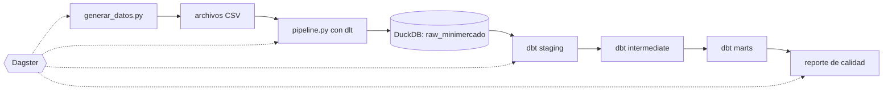

# Informe técnico: pipeline analítico de un minimercado

**Equipo tp-data-G1**

## 1. Cómo armamos el pipeline

El diagrama muestra el camino de los datos, de izquierda a derecha. Seguimos la idea de **ELT** de clase: primero guardamos los datos como llegan y después los transformamos.

1. **Generación.** `generar_datos.py` inventa los de un minimercado durante 120 días, del 1 de julio al 28 de octubre de 2026. Simula cada día: primero llegan las compras y después las ventas, que nunca superan el stock. El resultado son cinco archivos CSV: productos, vendedores, compras, ventas y movimientos de stock. Con la semilla 42 siempre salen exactamente los mismos datos.
2. **Ingesta.** `pipeline.py` usa **dlt** para pasar los CSV a la base `data.duckdb`, en el esquema `raw_minimercado`. Usa `merge` con el `id` como clave: si lo corremos dos veces no se duplica nada.
3. **Transformación.** Con **dbt** limpiamos y organizamos los datos en tres capas: *staging* corrige tipos y nombres, *intermediate* arma el historial de stock y el detalle de cada venta, y *marts* deja las tablas finales para analizar.
4. **Orquestación.** **Dagster** ejecuta los pasos anteriores en orden con un solo comando. Cada paso es un *asset* y con `deps` le indicamos de cuál depende. Al final, un paso más revisa que el resultado esté bien.

## 2. Decisiones que tomamos

**Sobre el modelado:**

- En *staging* solo limpiamos: fechas como fechas, importes con decimales y nombres sin espacios de más.
- Decidimos que la tabla `int_ventas_detalle` tenga **una fila por cada venta**. Todos los resúmenes salen de ahí, y por eso los totales coinciden entre las distintas tablas.
- La **rotación** de un producto es cuántas unidades vendimos dividido el stock promedio. El **punto de reposición** es lo que vendemos en promedio en 14 días: si el stock baja de ese número, hay que comprar. Los 14 días se pueden cambiar en `dbt_project.yml`.
- En la **clasificación ABC**, los productos que juntos llegan al 80 % de los ingresos son clase A, los que siguen hasta el 95 % son B y el resto, C.

**Sobre la calidad de los datos**, controlamos en tres lugares distintos:

- **dbt** tiene 48 pruebas: id sin repetir ni vacíos, ventas con productos y vendedores que existen, stock nunca negativo e importes positivos.
- **Dagster** tiene un paso final con 17 controles, por ejemplo que haya al menos 500 ventas y que la facturación dé lo mismo en todas las tablas. Se guardan en `reporte_calidad.json`.
- **pytest** tiene 7 pruebas: que con la misma semilla salgan los mismos datos, que las tablas tengan las columnas correctas, que cargar dos veces no duplique y que el pipeline completo funcione de principio a fin. En esa última también recalculamos la facturación en Python para compararla con la de dbt.

## 3. Lo que encontramos

**Ventas en general.** En los 120 días hubo 876 ventas y se vendieron 1.857 unidades. Se facturaron Gs. 20.446.575 y la ganancia bruta fue de Gs. 5.560.075, o sea un margen del 27,2 %. Cada venta dejó en promedio Gs. 23.341. Por día se facturó en promedio Gs. 170.388, con una mediana de Gs. 164.213 y una desviación estándar de Gs. 73.277. La desviación es grande: hay días muy distintos entre sí.

**El fin de semana es clave.** Los sábados y domingos se factura en promedio Gs. 232.464 por día, un 59 % más que de lunes a viernes (Gs. 145.847). En cambio, las ventas no crecen ni bajan con el tiempo: los cuatro meses dan entre Gs. 4,8 y 5,3 millones, y la regresión lineal da un R² de 0,008, prácticamente cero.

**Inventario.** La gaseosa cola es el producto que más rota (3,54 veces) y el único que quedó por debajo de su punto de reposición: le quedan 23 unidades y el mínimo es 26, así que hay que pedir ya. En el otro extremo, el maní salado rota solo 0,32 veces: con lo que hay, alcanzaría para 425 días.

**Vendedores y productos.** La mejor vendedora es Sofía Acosta, de la sucursal Sur, con Gs. 4.554.550, seguida de Carlos Gómez, de Centro. Lo curioso es que Sur es la sucursal que menos factura (22,3 % del total), porque tiene una sola vendedora; Centro hace el 40,2 % y Norte el 37,5 %. En el ABC, 11 de los 20 productos (clase A) generan el 81,2 % de los ingresos. La yerba mate es la que más factura, pero la gaseosa cola es la que más ganancia deja (Gs. 810.900). Por categoría, las bebidas son el 41,6 % de las ventas y los snacks tienen el mejor margen (30,6 %).

## 4. Limitaciones y qué mejoraríamos

- Los datos son inventados, así que los resultados reflejan las reglas que pusimos en el generador. Por ejemplo, el fin de semana vende más porque así lo programamos.
- Para la ganancia usamos el costo de catálogo, no lo que realmente se pagó en cada compra, que varía hasta un 5 %.
- No registramos mermas, devoluciones ni las ventas que se perdieron por falta de stock.
- Cada venta tiene un solo producto y 120 días no alcanzan para ver temporadas.
- Como mejoras: guardar el historial de precios con snapshots de dbt, procesar por día en Dagster y que GitHub ejecute las pruebas automáticamente en cada Pull Request.

## 5. Uso de herramientas de IA
Conforme a las pautas del curso, se utilizó Claude (Anthropic) como apoyo para las pruebas con pytest y para mejorar la redacción de la documentación. El equipo ejecutó, revisó y validó todo el contenido, y los resultados se obtuvieron de nuestras propias consultas sobre los datos.
